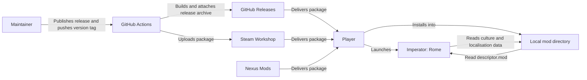
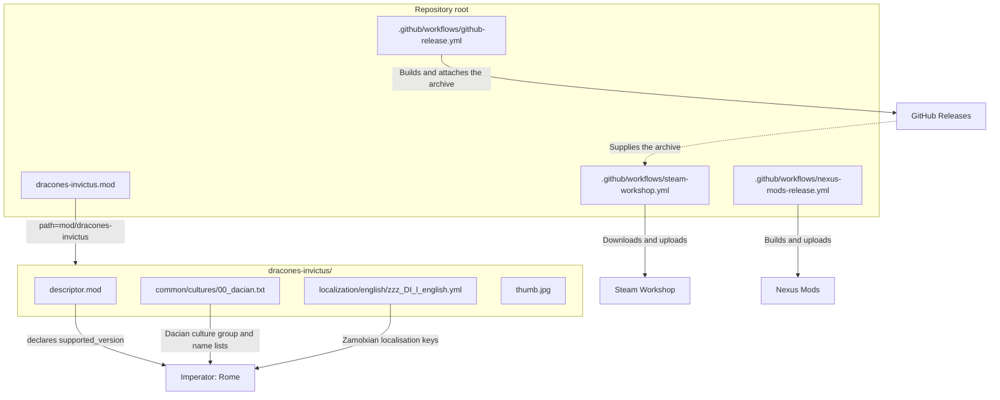
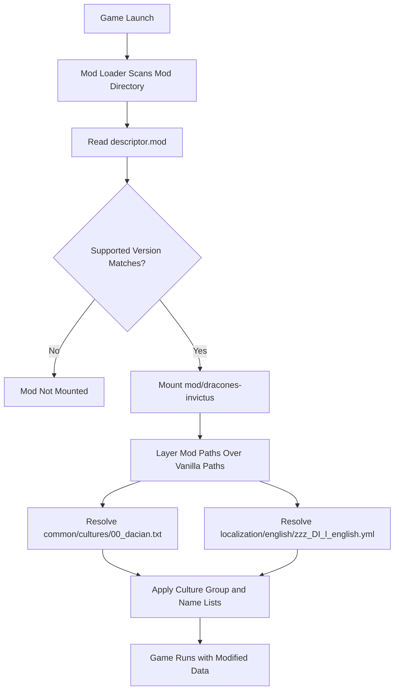
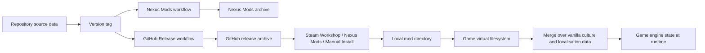
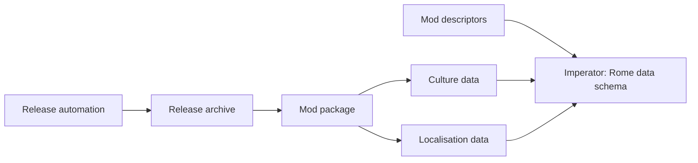

# Dracones Invictus Architecture

This document describes the current architecture of the Dracones Invictus mod for Imperator: Rome. It covers the data-only mod structure, the culture and localisation contracts that the game engine reads, the distribution channels, and the compatibility boundaries. It describes the implemented architecture, not a proposed one.

## 📑 Table of Contents

- [Purpose](#purpose)
- [System Context](#system-context)
- [Architectural Style](#architectural-style)
- [Runtime Process](#runtime-process)
- [Components](#components)
- [Architectural Areas](#architectural-areas)
  - [Mod Package](#mod-package)
  - [Culture Definitions](#culture-definitions)
  - [Localisation](#localisation)
  - [Distribution Automation](#distribution-automation)
- [Data Architecture](#data-architecture)
- [Interfaces and Integrations](#interfaces-and-integrations)
- [Culture Group Definition](#culture-group-definition)
- [Cross-Cutting Concerns](#cross-cutting-concerns)
  - [Security and Privacy](#security-and-privacy)
  - [Error Handling](#error-handling)
  - [Configuration](#configuration)
- [Dependency Direction and Rules](#dependency-direction-and-rules)
- [External Dependencies](#external-dependencies)
- [Deployment and Operations](#deployment-and-operations)
- [Compatibility Contracts](#compatibility-contracts)
- [Testing and Verification](#testing-and-verification)
- [Design Constraints](#design-constraints)
- [Extension Points](#extension-points)
  - [Extending Name Lists](#extending-name-lists)
  - [Extending Localisation and Culture Data](#extending-localisation-and-culture-data)
- [Source Map](#source-map)
- [Related Documentation](#related-documentation)

## 🎯 Purpose

This document records the architecture of a content-only mod for Imperator: Rome that expands the Dacian culture group with additional male and female names, family names, and localisation text. The audience is maintainers and contributors who require comprehension of the mod package layout, the culture and localisation contracts, the override mechanism of the game's mod loader, and the release pipeline. The mod contains no executable code, runtime, scripting, or network communication, so its architecture is that of a declarative data override.

## 🌐 System Context

The mod operates entirely inside the Imperator: Rome game process. The game's mod loader reads the mod descriptor, mounts the mod directory into the virtual filesystem, and substitutes the mod's culture and localisation files for the vanilla files of the identical relative path. Players obtain the packaged mod from the Steam Workshop, Nexus Mods, or GitHub Releases, or install it manually into the game's mod directory.

The principal external boundaries are:
- **Imperator: Rome Mod Loader:** Reads `descriptor.mod`, mounts `mod/dracones-invictus/`, and resolves the mod's `common/cultures/` and `localization/` paths ahead of the vanilla equivalents. Owned by Paradox Interactive.
- **Steam Workshop:** Primary distribution channel, receiving each tagged package through the release workflow. Owned by Valve.
- **Nexus Mods:** Secondary distribution channel, receiving the tagged archive through the Nexus Mods workflow. Owned by Nexus Mods.
- **GitHub Releases:** Source release channel, holding the versioned archive that the GitHub Release workflow builds and attaches and the Workshop workflow downloads. Owned by GitHub.
- **Player Local Filesystem:** Holds the game installation, the mod directory, and the mounted files. Controlled by the player.

## 🏗️ Architectural Style

**Static Data Override / Content Mod**

The repository implements a pure content mod: a fixed set of Clausewitz-script data files that supersede the vanilla culture and localisation data through the game's native mod loading mechanism. There is no code, compilation, build step, runtime, or network interaction. The architectural consequences are:
- Zero runtime dependencies beyond the base game.
- Override precedence depends entirely on the game's virtual filesystem and on filename ordering within the same directory.
- Compatibility is governed by the game data format, the file paths, and the `supported_version` declaration in `descriptor.mod`.
- Changes are restricted to the culture definitions, the localisation text, the descriptors, and the thumbnail.

The principal architecture boundaries are:
- **Mod Descriptor (`descriptor.mod` and the root `dracones-invictus.mod`):** Declares mod identity, tags, supported game version, and mount path. Permitted dependency: Imperator: Rome 2.0.x.
- **Culture Data (`common/cultures/00_dacian.txt`):** Declares the `dacia_group` culture group, its name lists, family names, and constituent cultures. Permitted dependency: the game's culture data schema.
- **Localisation (`localization/english/zzz_DI_l_english.yml`):** Supplies English text for modified Zamolxian keys. Permitted dependency: the game's localisation key namespace.
- **Release Automation (`.github/workflows/github-release.yml`, `.github/workflows/steam-workshop.yml`, and `.github/workflows/nexus-mods-release.yml`):** The GitHub Release workflow builds and attaches the versioned archive; the Steam Workshop workflow retrieves that archive and uploads the package to the Steam Workshop; the Nexus Mods workflow builds its own archive and uploads it to Nexus Mods. None depends on the mod data beyond packaging it.

## 🔄 Runtime Process

The principal runtime sequence is:
1. The player starts Imperator: Rome with the mod enabled.
2. The game mod loader scans the mod directory and reads `descriptor.mod`.
3. The loader validates the `supported_version` declaration against the running game version.
4. The loader mounts the mod directory over the vanilla content paths in the virtual filesystem.
5. The game requests the culture group and localisation files at their relative paths.
6. The virtual filesystem resolves the mod data, which supersedes the vanilla equivalents.
7. The game runs with the expanded Dacian culture group and modified Zamolxian text.

## 🧩 Components

| Component | Responsibility | Principal Dependencies | Lifetime or Ownership |
|-----------|----------------|------------------------|-----------------------|
| `dracones-invictus.mod` | Declares the launcher-visible mod identity, tags, supported game version, and mount path | Imperator: Rome launcher and mod loader | Static file; revised per release |
| `dracones-invictus/descriptor.mod` | Declares the in-package descriptor that the game reads from the mounted directory | Imperator: Rome mod loader | Static file; mirrors the root descriptor |
| `dracones-invictus/common/cultures/00_dacian.txt` | Declares the `dacia_group` culture group, unit templates, name lists, family names, and constituent cultures | Imperator: Rome culture data schema | Static data; revised per content change |
| `dracones-invictus/localization/english/zzz_DI_l_english.yml` | Supplies English text for the modified Zamolxian faith keys | Imperator: Rome localisation loader | Static data; revised per content change |
| `dracones-invictus/thumb.jpg` | Provides the mod thumbnail displayed by the launcher and distribution channels | Launcher and distribution channel metadata handling | Static asset; revised per release |
| `.github/workflows/github-release.yml` | Builds the versioned archive from the released tag and attaches it to the GitHub release | GitHub Actions, GitHub Releases | Repository automation; executes per published release |
| `.github/workflows/steam-workshop.yml` | Retrieves the tagged release archive and uploads the package to the Steam Workshop | GitHub Actions, GitHub Releases, Steam Workshop | Repository automation; executes per version tag |
| `.github/workflows/nexus-mods-release.yml` | Builds the versioned archive from the tagged content and uploads it to Nexus Mods | GitHub Actions, Nexus Mods | Repository automation; executes per version tag |

## 🗂️ Architectural Areas

### Mod Package

Paths:
- `dracones-invictus/`
- `dracones-invictus.mod`

Responsibilities:
- Provide the complete mountable mod package with the directory layout the game expects.
- Declare mod metadata, tags, supported game version, and mount path.

Boundary rules:
- The mod directory name must match the `path` declaration in both descriptors.
- `common/cultures/` and `localization/english/` must preserve the vanilla relative paths so the virtual filesystem resolves the override.
- No executable content, installers, or scripts are permitted in the package.

### Culture Definitions

Paths:
- `dracones-invictus/common/cultures/00_dacian.txt`

Responsibilities:
- Define the `dacia_group` culture group, its colour, unit templates, male and female name lists, family names, and constituent cultures.

Boundary rules:
- The file must keep the Clausewitz block syntax of the vanilla culture files.
- Vanilla name blocks are preserved and extended rather than replaced.
- The `00_` filename prefix keeps the file ahead of vanilla culture files in load order.

### Localisation

Paths:
- `dracones-invictus/localization/english/zzz_DI_l_english.yml`

Responsibilities:
- Supply English text for the Zamolxian faith keys that the mod renames.

Boundary rules:
- Keys must remain namespaced to the `l_english` header and must not collide with vanilla keys that the mod does not intend to supersede.
- The `zzz_DI_` filename prefix places the file after vanilla localisation files, so its records win the last-wins resolution.

### Distribution Automation

Paths:
- `.github/workflows/github-release.yml`
- `.github/workflows/steam-workshop.yml`
- `.github/workflows/nexus-mods-release.yml`

Responsibilities:
- Build the versioned archive from the released tag and attach it to the GitHub release.
- Download the versioned archive attached to the triggered release.
- Upload the unpacked package to the Steam Workshop item.
- Build and upload the versioned archive to Nexus Mods.

Boundary rules:
- Steam and Nexus credentials are supplied only through repository secrets and are never committed.
- The Workshop workflow depends on the release archive existing for the pushed tag.
- The archive is produced by the GitHub Release workflow rather than attached by hand.

## 💾 Data Architecture

The mod owns no runtime state, database, or cache. Its data artefacts are declarative text files and one binary asset, all of which the game reads through its virtual filesystem. The architecture therefore consists of source data, its packaged representation, and the mounted resolution path.

| Data or Store | Owner | Representation and Storage | Lifecycle or Consistency |
|---------------|-------|----------------------------|--------------------------|
| `dacia_group` culture group | Mod maintainers | Clausewitz script inside `common/cultures/00_dacian.txt` | Revised per content change; supersedes the vanilla declaration at mount time |
| Male and female name lists | Mod maintainers | Space-separated name tokens in named blocks inside the culture group | Vanilla tokens preserved; mod tokens appended; no per-record identity |
| Family names | Mod maintainers | Four-part dot-separated name tuples inside the culture group | Declarative and order-independent |
| Localisation records | Mod maintainers | `key:0 "text"` lines under the `l_english` header | Last file in load order wins; only the modified Zamolxian keys are declared |
| Mod thumbnail | Mod maintainers | Binary JPEG at `dracones-invictus/thumb.jpg` | Replaced per release; read by launcher and distribution channels |
| Runtime game state | Player and game engine | In-memory engine state plus player save files | Not owned, read, or written by the mod |

## 🔌 Interfaces and Integrations

| Interface or Integration | Direction | Contract | Owner | Failure Semantics |
|--------------------------|-----------|----------|-------|-------------------|
| Imperator: Rome mod loader | Inbound | `descriptor.mod` syntax; `supported_version="2.0.*"`; mount path `mod/dracones-invictus` | Paradox Interactive | A version mismatch or malformed descriptor prevents the mod from mounting; the game proceeds with vanilla data |
| Culture data schema | Inbound | Clausewitz block syntax and the culture group field set | Paradox Interactive | A malformed block causes the game to discard or ignore the culture data |
| Localisation loader | Inbound | `l_english:` header with `key:0 "text"` records | Paradox Interactive | An unknown or malformed key is ignored; neighbouring keys remain unaffected |
| GitHub Actions release triggers | Inbound | Publication of a GitHub release, and push of a `v*.*.*` tag for the Workshop and Nexus Mods uploads | Repository maintainers | A missing or misnamed release archive fails the Workshop workflow before upload |
| Steam Workshop upload | Outbound | `hmlendea/steam-workshop-update` action with application identifier `859580` and item identifier `1745923673` | Steam and the action author | An authentication or upload failure aborts the job; the published item retains its previous content |
| Nexus Mods upload | Outbound | `Nexus-Mods/upload-action` with file identifier `526528` | Nexus Mods | An authentication or upload failure aborts the job; the mod file retains its previous version |
| GitHub Releases, Nexus Mods, manual installation | Outbound | Versioned archive of the mod directory, or the directory contents directly | Repository maintainers | A mismatched archive or partial extraction yields an incomplete mod directory |

## ⚙️ Culture Group Definition

The `dacia_group` block is the architectural centre of the mod. It declares, in order, the group colour, the levy unit composition, the levy template reference, the male and female name lists, the family names, and the constituent culture list.

| Field | Content in this mod | Architectural consequence |
|-------|---------------------|---------------------------|
| `color` | HSV triple for the culture group colour | Presentation only; no behavioural effect |
| `primary`, `second`, `flank`, navigation fields | Unit type references such as `archers`, `heavy_infantry`, `light_cavalry`, and the naval vessel tiers | Declarative references into the vanilla unit type namespace |
| `levy_template` | Reference to `levy_dacians` | Couples the group to a levy template defined elsewhere in vanilla data |
| `male_names`, `female_names` | Vanilla tokens retained under a comment, mod tokens appended under a mod comment | Names accumulate; the block is order-independent rather than positional |
| `family` | Dot-separated four-part tuples | Order-independent declaration of family name forms |
| `culture` | Named culture records including `dacian`, `getian`, `triballoi`, `moesi`, `harpii`, and `costoboci`, each with an empty body | Culture identifiers are keys, so an unknown identifier is inert rather than fatal |

## 🧵 Cross-Cutting Concerns

### Security and Privacy

The trust boundary is the local filesystem: the mod supplies declarative data that the game reads, and it neither accepts untrusted input nor communicates over a network. Release automation holds Steam credentials exclusively in repository secrets, which the workflow injects as environment variables at execution time; no credential is present in the repository. The mod handles no personal data, as recorded in [PRIVACY.md](./PRIVACY.md), and the reporting procedure for the distribution surface is recorded in [SECURITY.md](./SECURITY.md).

### Error Handling

The mod owns no error handling because it contains no runtime logic. Failure translation belongs to the host: a malformed descriptor prevents mounting, and malformed culture or localisation data is discarded or ignored by the game with the vanilla data retained as the fallback. Contributors verify data well-formedness before committing, as described in [CONTRIBUTING.md](./CONTRIBUTING.md).

### Configuration

| Configuration Area | Source | Responsibility | Supersede or Secret Policy |
|--------------------|--------|----------------|---------------------------|
| `supported_version` | `dracones-invictus.mod` and `dracones-invictus/descriptor.mod` | Governs whether the game mounts the mod | Must be revised when the target game version moves beyond 2.0.x |
| `path` | Both descriptors | Governs the mounted relative path | Must match the directory name `dracones-invictus` |
| `tags` | Both descriptors | Declares launcher-visible characteristics such as Ironman compatibility and interface modification | Metadata only |
| Steam identifiers | `.github/workflows/steam-workshop.yml` | Select the target application and Workshop item | Public values; credentials are supplied only from repository secrets |
| Release archive naming | `.github/workflows/github-release.yml` and `.github/workflows/steam-workshop.yml` | Build and retrieve the versioned archive | Contract on the archive name; see [docs/invariants.md](./docs/invariants.md) |
| Load-order prefixes | Culture and localisation filenames | Determine resolution precedence against vanilla files | Prefix conventions are the only control over override order |

## 🧭 Dependency Direction and Rules

Dependency points inward from distribution and automation towards declarative data, and the mod depends on the host schema rather than the reverse.

The principal dependency rules are:
- Culture and localisation data may reference vanilla identifiers, but no file may reference repository automation.
- Release automation may read the packaged data but must never modify it.
- Both descriptors must remain mutually consistent; divergence governs mounting behaviour.
- The mod data must not depend on other mods, and it must not declare dependencies on loaders or libraries.
- No file outside the mod directory may embed game data, so the package remains independently mountable.

## 📦 External Dependencies

| Dependency | Responsibility | Integration Boundary | Architectural Consequence |
|------------|----------------|----------------------|---------------------------|
| Imperator: Rome 2.0.x data schema | Supplies the culture group, unit type, levy template, and localisation key namespaces | Mod data files | Any schema change in the host requires revision of the mod data and of `supported_version` |
| GitHub Actions | Executes the release workflows | `.github/workflows/github-release.yml`, `.github/workflows/steam-workshop.yml`, `.github/workflows/nexus-mods-release.yml` | Release capability depends on the workflows retaining valid secret bindings |
| `hmlendea/steam-workshop-update` action | Performs the Workshop item upload | Steam Workshop upload step | The workflow couples to the action's input interface |
| `Nexus-Mods/upload-action` action | Performs the Nexus Mods file upload | Nexus Mods upload step | The workflow couples to the action's input interface |
| Steam Workshop platform | Hosts and delivers the published item | Distribution channel | Published content is visible to players independent of repository state |

## 🚀 Deployment and Operations

The deployment unit is a directory tree that the game mounts, not a process or service. Operators are the players who install the mod and the maintainers who publish it.

| Concern | Current Design | Architectural Consequence |
|---------|----------------|---------------------------|
| Process topology | No process; the mod loads into the single Imperator: Rome client process | No hosting, scaling, availability, or recovery obligations exist |
| Deployment unit | The `dracones-invictus/` directory, distributed as a versioned archive | Installation is the extraction of the directory into the game's mod path |
| Persistent state | None owned by the mod; game save files remain outside its scope | Uninstallation consists of deleting the mod directory |
| Target application | Steam application identifier `859580`; Workshop item `1745923673` | Release automation is bound to those identifiers |
| Release trigger | Publication of a GitHub release, and push of a `v*.*.*` tag for the Workshop and Nexus Mods uploads | The release must be published before the Workshop workflow can retrieve its archive |
| Scaling assumptions | None; every installation is independent and identical | No central component requires capacity planning |
| Operator responsibility | Players manage installation, revision, and deletion; maintainers manage publication and version declarations | No operational guarantee accompanies the published package |

## 🛡️ Compatibility Contracts

| Contract | Owner | Invariant | Verification | Change Policy |
|----------|-------|-----------|--------------|---------------|
| `descriptor.mod` field set | Mod maintainers | `name`, `tags`, `supported_version`, and `path` remain parseable by the launcher and loader | Manual inspection of both descriptors | Field additions require explicit descriptor test in game |
| Mount path | Mod maintainers | `path="mod/dracones-invictus"` matches the directory name | Manual inspection | A rename requires simultaneous revision of both descriptors |
| `supported_version` | Mod maintainers | Declares `2.0.*` | Game mount attempt | Revise only when the target game version changes |
| Culture group identifier | Mod maintainers | `dacia_group` remains the group key | Game load of the culture data | Renaming breaks references to the group key |
| Culture identifiers | Mod maintainers | Existing identifiers such as `dacian` and `getian` remain present | Game load of the culture data | Retain identifiers that vanilla saves or data reference |
| Localisation filename prefix | Mod maintainers | `zzz_DI_` keeps the file after vanilla localisation files | Game display of the Zamolxian text | A prefix change alters which file wins resolution |
| Culture filename prefix | Mod maintainers | `00_` keeps the file ahead of vanilla culture files | Game load of the culture data | A prefix change alters load precedence |

## ✅ Testing and Verification

The repository contains no automated test suite and no compilation step, so verification is manual and data-oriented:

- Inspect the Clausewitz block balance in `dracones-invictus/common/cultures/00_dacian.txt` after every content revision.
- Confirm that both descriptors remain mutually consistent after any metadata change.
- Load the mod in a supported Imperator: Rome 2.0.x installation and confirm that the expanded Dacian name lists and the revised Zamolxian text appear as intended.
- Confirm that the packaged archive extracts into a directory tree that the game mounts without a descriptor warning.
- Confirm through a published release that the GitHub Release workflow attaches the archive, and through a version tag that the Workshop and Nexus Mods workflows complete their uploads.

A per-culture manual check list is the material coverage gap: no automated validation compares the mod against the vanilla schema, so a schema change in the host may pass unnoticed until a manual load reveals it.

## ⚠️ Design Constraints

- **Host-owned schema:** The mod cannot define culture group semantics; it can only declare values in the field set that Imperator: Rome recognises.
- **Override by path and filename:** Resolution precedence depends on the relative path and the filename prefix, so an unintended rename silently changes which data wins.
- **No computed content:** Name lists and family names are enumerations, so scaling the content requires linear authoring effort.
- **Single-language localisation:** Only English text is supplied; other language clients fall back to vanilla or to missing text.
- **Credential dependency for publication:** The Workshop channel cannot be updated without repository secrets available to the workflow.
- **No automated regression detection:** Manual in-game verification is the only check that the data remains valid against the host schema.

## 🔧 Extension Points

### Extending Name Lists

1. Open `dracones-invictus/common/cultures/00_dacian.txt` and locate the target `male_names`, `female_names`, or `family` block.
2. Append tokens within the existing block, retaining the vanilla tokens and the block syntax.
3. Load the mod and confirm the additional names appear in the character naming pool.

Names accumulate within a block and are order-independent, so no positional contract constrains an addition as long as the block remains balanced. Contribution guidance and source-attribution expectations are recorded in [CONTRIBUTING.md](./CONTRIBUTING.md).

### Extending Localisation and Culture Data

1. Declare a new record in `dracones-invictus/localization/english/zzz_DI_l_english.yml` under the `l_english` header, or declare a culture record inside the `culture` block of the culture group.
2. Retain the `zzz_DI_` filename prefix so the localisation file keeps last-wins precedence, and retain the `00_` prefix on the culture file.
3. Load the mod and confirm the key resolves to the intended text and that the culture group retains every prior culture.

Localisation keys must not collide with vanilla keys that the mod does not intend to supersede, and any culture identifier added to the group must remain present thereafter because vanilla saves and other data may reference it.

## 🗺️ Source Map

| Area | Path |
|------|------|
| Mod package root | `dracones-invictus/` |
| Launcher descriptor | `dracones-invictus.mod` |
| In-package descriptor | `dracones-invictus/descriptor.mod` |
| Culture definitions | `dracones-invictus/common/cultures/00_dacian.txt` |
| English localisation | `dracones-invictus/localization/english/zzz_DI_l_english.yml` |
| Mod thumbnail | `dracones-invictus/thumb.jpg` |
| Release automation | `.github/workflows/github-release.yml`, `.github/workflows/steam-workshop.yml`, `.github/workflows/nexus-mods-release.yml` |

## 📚 Related Documentation

- [README.md](./README.md) records the project overview, the perceived features, and the installation channels.
- [CONTRIBUTING.md](./CONTRIBUTING.md) records the contribution procedure, the prerequisites, and the data conventions that this document assumes.
- [PRIVACY.md](./PRIVACY.md) records the data-handling position of a mod that handles no personal data.
- [SECURITY.md](./SECURITY.md) records the supported versions, the report scope, and the coordinated disclosure policy.
- [CODE_OF_CONDUCT.md](./CODE_OF_CONDUCT.md) records the conduct expected in project spaces.
