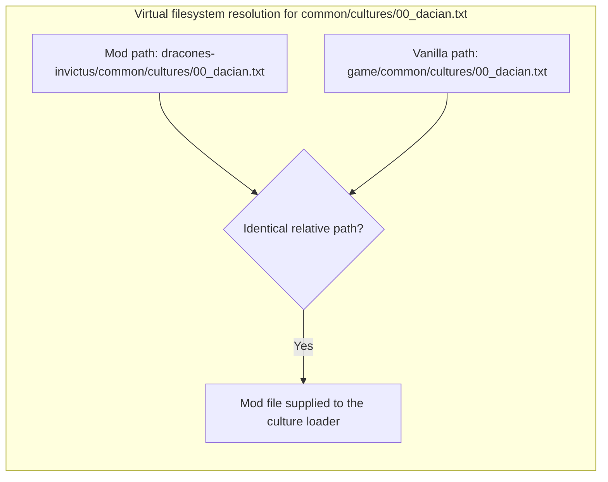
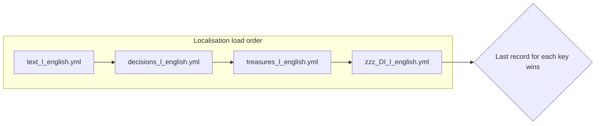
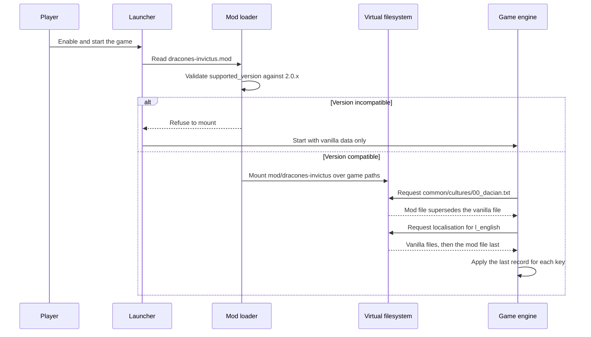
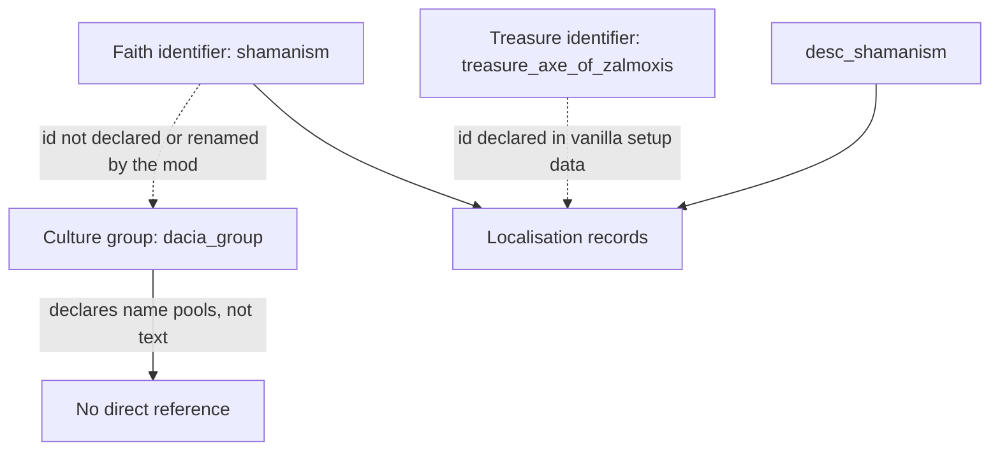

# Architecture

This document elaborates the architecture summarised in [../../ARCHITECTURE.md](../ARCHITECTURE.md). The root document defines the system context, components, contracts, and constraints. This document concentrates on the mechanics that a future agent or contributor would otherwise have to rediscover from the data files: the precise override semantics of each surface, the reason the two mechanisms differ, and the consequences for change.

## Two override mechanisms, one mod

The repository uses two structurally different override mechanisms, and confusing them is the principal source of error in this codebase.

### Mechanism one: whole-file supersession by identical path

The culture data relies on path identity.

Consequences:

- The mod file is a **complete replacement**, not a patch. Every field it omits is lost for the group.
- The file must remain syntactically self-sufficient.
- Adding a name requires reproducing the whole group, which is why the file carries vanilla tokens verbatim with a `# Vanilla` comment and mod tokens after a `# Dracones Invictus - Dacian` comment. The comments are for maintainers; the loader ignores them.

### Mechanism two: record supersession by later load order

The localisation data relies on ordering.

Consequences:

- The mod file declares only the keys it intends to supersede. It is a delta, not a replacement.
- Supersession depends on the filename sorting after every vanilla file that declares the same key. The `zzz_` segment provides that margin, and the `DI_` segment namespaces the file.
- A key that the mod mistypes does not supersede anything; it defines a new, unused key. This is exactly what has occurred with the treasure name record, documented in [api-reference/INDEX.md](./api-reference/INDEX.md) and [operations/troubleshooting.md](./operations/troubleshooting.md#the-treasure-display-name-does-not-change).

## Why the mechanisms differ

The difference is imposed by the host, not chosen by the repository.

| Surface | Host resolution model | Reason |
|---------|----------------------|--------|
| Culture data | One definition per culture group. The loader takes the file that resolves for the path. | A culture group is a single named object, so a partial second declaration has no defined merge semantics. |
| Localisation | Many records per key across many files. The loader takes the last record for a key. | Localisation is a flat key-value namespace, so records compose naturally. |

Recording this distinction is the reason this document exists. A contributor who assumes the localisation model applies to the culture data would attempt a partial culture file and silently lose the group definition.

## Resolution sequence

The sequence has no mod-owned step. Every action belongs to the host; the mod contributes data and a version gate.

## Loading order and prefix economics

| File | Prefix | Competitive position | Why it matters |
|------|--------|----------------------|----------------|
| `00_dacian.txt` | `00_` | Ties with the vanilla file of the identical name | The tie is decided by path identity, so the prefix matters chiefly for legibility against the vanilla layout |
| `zzz_DI_l_english.yml` | `zzz_DI_` | Sorts after every vanilla `*_l_english.yml` file | Provides the last-wins margin for every superseded record |

The culture prefix and the localisation prefix therefore serve different purposes despite looking similar. Neither prefix is decorative; both are recorded as contracts in [configuration.md](./configuration.md) and [invariants.md](./invariants.md).

## Cross-references between the two surfaces

The two surfaces meet at a single, easily overlooked point.

- The mod does **not** rename the faith identifier. It leaves the identifier `shamanism` and the treasure identifier `treasure_axe_of_zalmoxis` untouched, and supersedes only their display text. The identifier remains a vanilla contract.
- The mod does **not** declare the identifiers themselves. It relies on the host declaring them and supersedes the text that the host renders for them.
- Consequently, the culture data and the localisation data are independent. Neither references the other by identifier, and a change to one cannot break the other.
- The one nominal exception is `levy_template = levy_dacians`, which references a template owned by the host at `game/common/levy_templates/01_dacians.txt`. The mod does not define that template and must not, unless it intends to supersede the whole template file.

## Composition boundaries

| Boundary | Owner | What crosses it | Permitted change |
|----------|-------|-----------------|------------------|
| Mod package to host loader | Paradox Interactive | Declarative data at host-defined paths | Any valid data at those paths |
| Mod data to host identifier namespace | Paradox Interactive | Names of culture groups, cultures, unit types, levy templates, localisation keys | References to existing identifiers; new identifiers only where the host permits definition |
| Repository to release pipeline | Repository maintainers | A correctly named release archive | The pipeline may be revised freely within its own contract |
| Release pipeline to Steam | Valve | The unpacked mod directory and credentials from secrets | No mod data is transformed at this boundary |

## Architectural risk summary

| Risk | Mechanism | Consequence | Mitigation recorded |
|------|-----------|-------------|---------------------|
| Silent content loss | Whole-file supersession | A field omitted during a revision disappears in game without an error | [invariants.md](./invariants.md) mandates a complete-file check |
| Silent no-op text change | Last-wins record supersession | A mistyped key defines an unused key and changes nothing visible | [testing.md](./testing.md) prescribes a key-by-key visual check |
| Version gate closure | `supported_version="2.0.*"` | A host version outside 2.0.x refuses to mount the mod | [configuration.md](./configuration.md) records the revision procedure |
| Pipeline breakage | Release archive name contract | A renamed or manually attached asset fails the download step | [build-and-deployment.md](./build-and-deployment.md) records the asset naming contract |

## Related documentation

- [api-reference/INDEX.md](./api-reference/INDEX.md) — the contracts in reference form.
- [data-model.md](./data-model.md) — the entities and their lifecycles.
- [flows/startup-and-mounting.md](./flows/startup-and-mounting.md) — the loading sequence in detail.
- [invariants.md](./invariants.md) — the properties that must hold.
- [design-decisions.md](./design-decisions.md) — why the content is shaped as it is.
