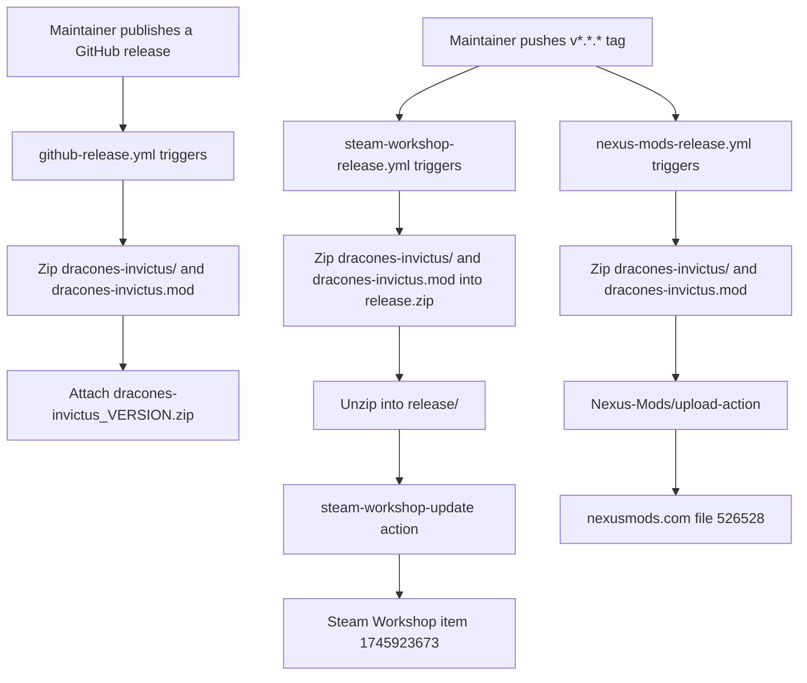

# Build and deployment

## There is no build

The repository has no compilation step, no dependency restoration, no bundling, no minification, and no generated artefact. The mod directory is already the deliverable. "Build" in this project means only "package the directory into a correctly named archive".

| Stage | Present? | Notes |
|-------|----------|-------|
| Dependency restoration | No | No manifest or lockfile exists |
| Compilation or transpilation | No | All content is declarative data |
| Bundling | No | The directory is the unit |
| Static analysis | No | No linter or analyser configuration exists |
| Tests | No | No test project exists |
| Packaging | Yes | `.github/workflows/github-release.yml` zips the mod directory and descriptor into the release archive; `nexus-mods-release.yml` also zips them for the Nexus upload |
| Publishing | Yes | `.github/workflows/github-release.yml` attaches the archive to the GitHub release; `steam-workshop-release.yml` builds and uploads to the Steam Workshop; `nexus-mods-release.yml` builds and uploads to Nexus Mods |

## Release pipeline

The pipeline does not compile anything. It packages the already-authored mod directory. All three workflows build their own archive from the checked-out tag; none of them consumes a previously attached release asset. The `github-release.yml` workflow runs on release publication, while the Workshop and Nexus Mods workflows run on the `v*.*.*` tag push.

## Workflow reference

### GitHub Release workflow

| Property | Value |
|----------|-------|
| File | `.github/workflows/github-release.yml` |
| Name | `GitHub Release` |
| Trigger | `release: types: [ published ]`, or manual `workflow_dispatch` with a required `tag` input |
| Runner | `ubuntu-latest` |
| Job | `release`, named `Build and publish` |
| Steps | `Check out the repository`, `Extract the version from the GitHub tag`, `Build the release archive`, `Publish the release asset` |
| Action used | `softprops/action-gh-release@v2` |
| Secrets consumed | `GITHUB_TOKEN` |
| Permission | `contents: write` |

The workflow checks out the released tag, builds `dracones-invictus_<version>.zip` from `dracones-invictus/` and `dracones-invictus.mod`, and attaches it to the release for the requested tag. The version is the tag name with a leading `v` removed.

### Steam Workshop workflow

| Property | Value |
|----------|-------|
| File | `.github/workflows/steam-workshop-release.yml` |
| Name | `Steam Workshop` |
| Trigger | `push` of a tag matching `v*.*.*`, or manual `workflow_dispatch` with a required `tag` input |
| Runner | `ubuntu-latest` |
| Job | `release`, named `Release` |
| Steps | `Build the release archive`, `Extract the release archive`, `Upload` |
| Action used | `hmlendea/steam-workshop-update@latest` |
| Secrets consumed | `STEAM_USERNAME`, `STEAM_PASSWORD`, `STEAM_2FA_SEED` |

The workflow checks out the requested tag, builds `release.zip` from `dracones-invictus/` and `dracones-invictus.mod`, extracts it into `release/`, and uploads `release/dracones-invictus/` to the Workshop item.

### Nexus Mods workflow

| Property | Value |
|----------|-------|
| File | `.github/workflows/nexus-mods-release.yml` |
| Name | `Nexus Mods` |
| Trigger | `push` of a tag matching `v*.*.*`, or manual `workflow_dispatch` with a required `tag` input |
| Runner | `ubuntu-latest` |
| Job | `release`, named `Release` |
| Steps | `Build the release archive`, `Upload` |
| Action used | `Nexus-Mods/upload-action@v1.0.0-beta.11` |
| Secrets consumed | `NEXUSMODS_API_KEY` |

The workflow checks out the requested tag, builds `release.zip` from `dracones-invictus/` and `dracones-invictus.mod`, and uploads it to Nexus Mods file `526528` as `dracones-invictus.zip`, with `archive_existing_version` and `update_mod_version` enabled.

### Workshop upload step

| Input | Value |
|-------|-------|
| `appid` | `859580` (Imperator: Rome) |
| `itemid` | `1745923673` (Dracones Invictus Workshop item) |
| `path` | `release/dracones-invictus/` |
| `changenote` | A Steam-formatted link to `https://github.com/hmlendea/imperator-dracones-invictus/releases/tag/<tag>` |

The change note points at this repository's release page. The earlier workflow linked to `more-cultural-names`; that defect is corrected by this workflow, as recorded in [operations/ambiguities-and-open-questions.md](./operations/ambiguities-and-open-questions.md).

## Release procedure

1. Confirm that both descriptors carry the intended `supported_version` and that `name` is unchanged.
2. Confirm that the culture file declares the complete `dacia_group` with every field present.
3. Confirm that every localisation key matches a host key exactly.
4. Run the manual validation checklist in [testing.md](./testing.md).
5. Push the tag matching `v*.*.*` and publish the GitHub release for it.
6. The `github-release.yml` workflow builds `dracones-invictus_<version>.zip` from the tag and attaches it to the release.
7. Verify that the version suffix in the asset filename equals the tag without the leading `v`.
8. The `steam-workshop-release.yml` workflow builds its own archive from the tag and publishes it to the Workshop.
9. The `nexus-mods-release.yml` workflow builds its own archive from the tag and uploads it to Nexus Mods.
10. Verify all three workflow runs, the attached release asset, the Workshop item, and the Nexus Mods file.

Steps 1 through 5 are manual. The repository automates the archive construction, the release attachment, the Workshop publication, and the Nexus Mods upload. All three workflows are independent: each builds its own archive from the checked-out tag, so the release publication only affects the GitHub release asset and does not gate the Workshop or Nexus Mods uploads.

## Distribution channels

| Channel | Mechanism | Automation | Verification |
|---------|-----------|------------|--------------|
| Steam Workshop | Workflow upload to item `1745923673` | Automated on tag push | Inspect the workflow run and the item page |
| GitHub Releases | Archive attached by the GitHub Release workflow | Automated on release publication | Inspect the workflow run and the release page |
| Nexus Mods | Workflow upload to `imperatorrome/mods/24` (file `526528`) | Automated on tag push | Inspect the workflow run and the mod page |
| Manual installation | Player extracts the archive into the game mod directory | None | Load the game and confirm the content |

## Environments

| Environment | Purpose | Deployment method |
|-------------|---------|-------------------|
| Maintainer workstation | Authoring, local validation, release creation | Direct file editing and manual game load |
| GitHub Actions `ubuntu-latest` | GitHub release, Workshop, and Nexus Mods publication | Workflows on tag push, and the GitHub Release workflow on release publication |
| Player machine | Consumption | Workshop subscription, archive extraction, or launcher installation |

There is no staging environment, no canary, no rollback mechanism, and no feature flag. A defective release is corrected by publishing a further release.

## Packaging requirements

| Requirement | Reason |
|-------------|--------|
| The mod directory name must be `dracones-invictus` | The descriptor `path` and the mount contract refer to it |
| `descriptor.mod` must be inside the package | The loader reads it after mounting |
| The archive must contain the directory tree at its root, not nested inside an extra folder | The Workshop workflow unzips into `release/` and uploads `release/dracones-invictus/`, so an extra nesting level produces a doubly nested mod |
| `thumb.jpg` must accompany the package | Launcher and distribution channels display it |
| No compiled, temporary, or editor backup files may be included | The package is mounted wholesale as game data |

## Rollback

The repository defines no rollback procedure. A published Workshop item retains its previous content only until the next successful upload replaces it, and a player may subscribe to a specific manual version only through the non-automated channels. This is recorded as a constraint rather than as a design choice.

## Related documentation

- [flows/release-and-publishing.md](./flows/release-and-publishing.md) — the same process as an annotated flow.
- [integrations.md](./integrations.md) — the external systems involved.
- [configuration.md](./configuration.md) — the descriptor fields that the pipeline preserves.
- [operations/troubleshooting.md](./operations/troubleshooting.md#publishing-failures) — failure diagnosis.
