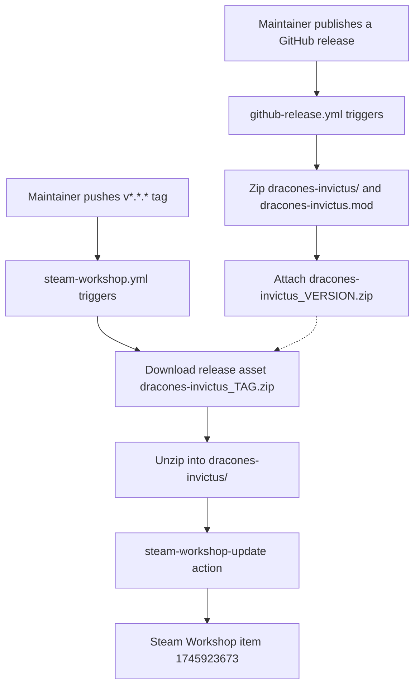

# Build and deployment

## There is no build

The repository has no compilation step, no dependency restoration, no bundling, no minification, and no generated artefact. The mod directory is already the deliverable. "Build" in this project means only "package the directory into a correctly named archive".

| Stage | Present? | Notes |
|-------|----------|-------|
| Dependency restoration | No | No manifest or lockfile exists |
| Compilation or transpilation | No | All content is declarative data |
| Bundling | No | The directory is the unit |
| Static analysis | No | No linter or analyser configuration exists |
| Tests | No | No test project exists |
| Packaging | Yes | `.github/workflows/github-release.yml` zips the mod directory and descriptor into the release archive |
| Publishing | Yes | `.github/workflows/github-release.yml` attaches the archive to the GitHub release; `steam-workshop.yml` uploads it to the Steam Workshop |

## Release pipeline



The pipeline does not compile anything. It packages the already-authored mod directory. The `github-release.yml` workflow produces the archive on release publication, and the `steam-workshop.yml` workflow consumes that archive on tag push, so the release must be published before the Workshop upload runs.

## Workflow reference

### GitHub Release workflow

| Property | Value |
|----------|-------|
| File | `.github/workflows/github-release.yml` |
| Name | `GitHub Release` |
| Trigger | `release: types: [ published ]`, or manual `workflow_dispatch` with a required `tag` input |
| Runner | `ubuntu-latest` |
| Job | `release`, named `Build and publish` |
| Steps | `Check out the repository`, `Extract the version from the GitHub tag`, `Build the release archive`, `Publish the release asset` |
| Action used | `softprops/action-gh-release@v2` |
| Secrets consumed | `GITHUB_TOKEN` |
| Permission | `contents: write` |

The workflow checks out the released tag, builds `dracones-invictus_<version>.zip` from `dracones-invictus/` and `dracones-invictus.mod`, and attaches it to the release for the requested tag. The version is the tag name with a leading `v` removed.

### Steam Workshop workflow

| Property | Value |
|----------|-------|
| File | `.github/workflows/steam-workshop.yml` |
| Name | `Steam Workshop` |
| Trigger | `push` of a tag matching `v*.*.*` |
| Runner | `ubuntu-latest` |
| Job | `release`, named `Release (Steam Workshop)` |
| Steps | `Prepare` (download and unzip), `Upload` (Workshop publish) |
| Action used | `hmlendea/steam-workshop-update@latest` |
| Secrets consumed | `STEAM_USERNAME`, `STEAM_PASSWORD`, `STEAM_2FASEED` |

### Download step

The download URL is constructed as:

```text
https://github.com/hmlendea/imperator-dracones-invictus/releases/download/${github.ref_name}/dracones-invictus_${GITHUB_REF:11}.zip
```

`${github.ref_name}` is the tag, for example `v2.0.0`. `${GITHUB_REF:11}` strips the `refs/tags/v` prefix, yielding `2.0.0` for that tag. The resulting asset name is therefore `dracones-invictus_2.0.0.zip`, which is the name that the `github-release.yml` build step produces.

This construction encodes two contracts: the asset must be attached to the release for the pushed tag, and the version suffix in its filename must match the tag without the leading `v`.

### Upload step

| Input | Value |
|-------|-------|
| `appid` | `859580` (Imperator: Rome) |
| `itemid` | `1745923673` (Dracones Invictus Workshop item) |
| `path` | `dracones-invictus/` |
| `changenote` | A Steam-formatted link to `https://github.com/hmlendea/more-cultural-names/releases/tag/<tag>` |

> **Defect to be aware of**: the change note links to `more-cultural-names`, a different repository, rather than to `imperator-dracones-invictus`. The published change note therefore points at the wrong release page. This is recorded in [operations/ambiguities-and-open-questions.md](./operations/ambiguities-and-open-questions.md).

## Release procedure

1. Confirm that both descriptors carry the intended `supported_version` and that `name` is unchanged.
2. Confirm that the culture file declares the complete `dacia_group` with every field present.
3. Confirm that every localisation key matches a host key exactly.
4. Run the manual validation checklist in [testing.md](./testing.md).
5. Push the tag matching `v*.*.*` and publish the GitHub release for it.
6. The `github-release.yml` workflow builds `dracones-invictus_<version>.zip` from the tag and attaches it to the release.
7. Verify that the version suffix in the asset filename equals the tag without the leading `v`.
8. The `steam-workshop.yml` workflow downloads the asset and publishes it to the Workshop.
9. Verify both workflow runs and the resulting Workshop item.

Steps 1 through 5 are manual. The repository automates the archive construction, the release attachment, and the Workshop publication. Because the Workshop workflow triggers on the tag push while the archive is attached on release publication, publish the release promptly after pushing the tag so the asset exists when the download step runs.

## Distribution channels

| Channel | Mechanism | Automation | Verification |
|---------|-----------|------------|--------------|
| Steam Workshop | Workflow upload to item `1745923673` | Automated on tag push | Inspect the workflow run and the item page |
| GitHub Releases | Archive attached by the GitHub Release workflow | Automated on release publication | Inspect the workflow run and the release page |
| Nexus Mods | Manual upload to `imperatorrome/mods/24` | Not automated | Inspect the mod page |
| Manual installation | Player extracts the archive into the game mod directory | None | Load the game and confirm the content |

## Environments

| Environment | Purpose | Deployment method |
|-------------|---------|-------------------|
| Maintainer workstation | Authoring, local validation, release creation | Direct file editing and manual game load |
| GitHub Actions `ubuntu-latest` | Workshop publication | Workflow on tag push |
| Player machine | Consumption | Workshop subscription, archive extraction, or launcher installation |

There is no staging environment, no canary, no rollback mechanism, and no feature flag. A defective release is corrected by publishing a further release.

## Packaging requirements

| Requirement | Reason |
|-------------|--------|
| The mod directory name must be `dracones-invictus` | The descriptor `path` and the mount contract refer to it |
| `descriptor.mod` must be inside the package | The loader reads it after mounting |
| The archive must contain the directory tree at its root, not nested inside an extra folder | The workflow unzips into `dracones-invictus/`, so an extra nesting level produces a doubly nested mod |
| `thumb.jpg` must accompany the package | Launcher and distribution channels display it |
| No compiled, temporary, or editor backup files may be included | The package is mounted wholesale as game data |

## Rollback

The repository defines no rollback procedure. A published Workshop item retains its previous content only until the next successful upload replaces it, and a player may subscribe to a specific manual version only through the non-automated channels. This is recorded as a constraint rather than as a design choice.

## Related documentation

- [flows/release-and-publishing.md](./flows/release-and-publishing.md) — the same process as an annotated flow.
- [integrations.md](./integrations.md) — the external systems involved.
- [configuration.md](./configuration.md) — the descriptor fields that the pipeline preserves.
- [operations/troubleshooting.md](./operations/troubleshooting.md#publishing-failures) — failure diagnosis.
