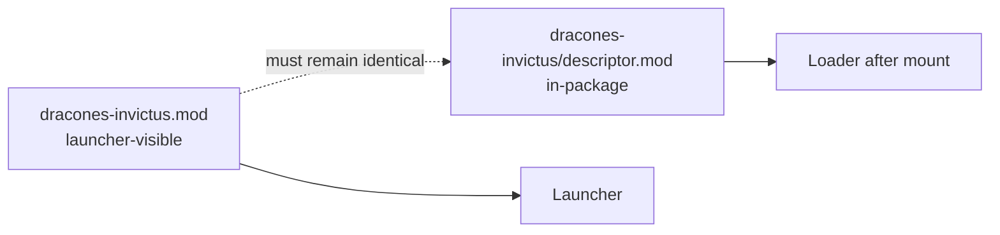

# Configuration

The mod exposes no runtime configuration surface. Everything configurable is declared statically at authoring time, and the only runtime input is the host's reading of those declarations.

## Configuration areas

| Area | Source | Responsibility | Precedence or secret policy |
|------|--------|----------------|-----------------------------|
| `name` | Both descriptors | Display name in the launcher and distribution channels | Duplicated in two files; both must carry the identical value |
| `tags` | Both descriptors | Launcher-visible characteristics | Duplicated; no precedence mechanism exists |
| `supported_version` | Both descriptors | Mount gate evaluated against the running host version | Duplicated; the loader evaluates the launcher-visible descriptor first |
| `path` | Both descriptors | Mount point for the mod content | Duplicated; the launcher-visible descriptor may be rewritten by the subscriber to an absolute Workshop path |
| Culture file prefix | Filename | Culture file ordering | Not configurable; encoded in the filename |
| Localisation file prefix | Filename | Localisation last-wins margin | Not configurable; encoded in the filename |
| Release tag | Git | Workshop workflow trigger and version suffix | Pattern `v*.*.*` |
| Release archive name | `.github/workflows/github-release.yml` | Archive construction and download step resolution | Must be `dracones-invictus_<tag-without-v>.zip` |
| Steam identifiers | `.github/workflows/steam-workshop.yml` | Upload target selection | Public values, hard-coded |
| Steam credentials | Repository secrets | Workshop authentication | Never present in the repository; injected as environment variables at run time |
| Nexus Mods file identifier | `.github/workflows/nexus-mods-release.yml` | Upload target selection | Public value, hard-coded (`526528`) |
| Nexus Mods API key | Repository secrets | Nexus Mods authentication | Never present in the repository; injected as an action input at run time |

## Version gate

`supported_version="2.0.*"` is the only field with a behavioural effect on whether the mod loads. It is a pattern, not an exact version, so the `*` accepts any patch and build within the 2.0 line.

The gate is evaluated by the host before mounting. A mismatch produces no mod-side error, because the mod runs no code. The observable outcome is the absence of the mod's content in game.

Procedure to revise the gate:

1. Change `supported_version` in `dracones-invictus.mod`.
2. Change `supported_version` in `dracones-invictus/descriptor.mod` to the identical value.
3. Confirm that the mod data still parses against the new host schema, because a schema change may accompany a version change.
4. Run the manual validation checklist in [testing.md](./testing.md).

## Load-order prefixes

Two filename prefixes act as configuration because the host derives precedence from filenames.

| File | Prefix | Effect of changing it |
|------|--------|-----------------------|
| `dracones-invictus/common/cultures/00_dacian.txt` | `00_` | The culture override relies on path identity rather than ordering, so a prefix change is unlikely to change behaviour but does leave the file misaligned with the host layout |
| `dracones-invictus/localization/english/zzz_DI_l_english.yml` | `zzz_DI_` | The `zzz_` segment provides the last-wins margin. Reducing it may cause a host file to sort after the mod file and win the records instead |

Treat both prefixes as contracts. See [invariants.md](./invariants.md).

## Descriptor duplication

The two descriptors are not linked. They duplicate four values by design, because the host has no include or reference mechanism.

| Value | Risk of divergence | Observable symptom |
|-------|--------------------|--------------------|
| `name` | Low impact | Inconsistent display name between launcher and package |
| `tags` | Low impact | Launcher characteristics differ from the package metadata |
| `supported_version` | High impact | The launcher may mount the mod while the loader evaluates a different gate, producing inconsistent behaviour |
| `path` | High impact | A mismatch between the declared mount point and the actual directory name prevents resolution |

## Environment variables and command-line options

None. The mod declares no environment variables and accepts no command-line arguments. The workflows consume five secrets (`GITHUB_TOKEN`, `STEAM_USERNAME`, `STEAM_PASSWORD`, `STEAM_2FASEED`, and `NEXUSMODS_API_KEY`), which are configuration of the pipeline rather than of the mod.

## Related documentation

- [api-reference/INDEX.md](./api-reference/INDEX.md) — the descriptor schema in reference form.
- [invariants.md](./invariants.md) — the properties that the configuration must preserve.
- [operations/change-guide.md](./operations/change-guide.md) — the revision procedures.
