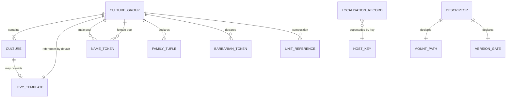
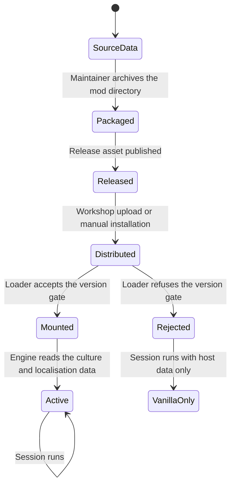

# Data model

## Entity inventory

| Entity | Identity | Definition site | Instances in this repository |
|--------|----------|-----------------|------------------------------|
| Culture group | Group key, `dacia_group` | `dracones-invictus/common/cultures/00_dacian.txt` | 1 |
| Culture | Culture key | Same file, `culture` block | 13 |
| Male name token | The token itself | Same file, `male_names` block | 125 |
| Female name token | The token itself | Same file, `female_names` block | 18 |
| Family name tuple | The dot-separated tuple | Same file, `family` block | 18 |
| Barbarian name token | The token itself | Same file, `barbarian_names` block | 10 |
| Unit composition reference | Identifier | Same file, top-level fields | 6 |
| Levy template reference | Identifier | Same file, `levy_template` and the `odrysi` record | 2 |
| Localisation record | Key | `dracones-invictus/localization/english/zzz_DI_l_english.yml` | 6 |
| Descriptor | File path | `dracones-invictus.mod`, `dracones-invictus/descriptor.mod` | 2, identical |
| Thumbnail | File path | `dracones-invictus/thumb.jpg` | 1 |
| Release asset | Version suffix | External, GitHub Releases | 1 per release |

## Entity relationships

Note that `LOCALISATION_RECORD` relates to a host-owned key and not to any entity in the culture file. The two halves of the mod are independent, as established in [architecture.md](./architecture.md).

## Culture group

| Attribute | Type | Value | Mutability |
|-----------|------|-------|-----------|
| Key | Identifier | `dacia_group` | Effectively immutable; referenced by host content |
| Colour | HSV triple | `hsv { 0.0 0.5 1.0 }` | Presentation only |
| Unit composition | Six identifiers | `archers`, `heavy_infantry`, `light_cavalry`, `tetrere`, `octere`, `liburnian` | Immutable without host-side validation |
| Default levy template | Identifier | `levy_dacians` | Immutable without host-side validation |
| Graphical culture | Identifier | `greek_gfx` | Immutable |
| Ethnicity weighting | Weighted identifier | `10 = levantine` | Immutable |

Lifecycle: the group exists only as a declaration. It is instantiated by the host when the culture data is loaded, and it exists for the duration of the game session. It is not persisted by the mod and is not serialised into save files by the mod's own action, though the host may reference the key in save data.

## Culture

| Attribute | Type | Cardinality | Notes |
|-----------|------|-------------|-------|
| Key | Identifier | 1 | The record name, for example `dacian` |
| Body | Block | 1 | Empty for all but `odrysi` |
| `levy_template` override | Identifier | 0 or 1 | Present only on `odrysi`, valued `levy_thracians` |

The 13 records present: `dacian`, `getian`, `triballoi`, `moesi`, `harpii`, `costoboci`, `buridavensi`, `caucoensi`, `ratacensi`, `biephi`, `odrysi`, `bithynian`, `mariandynian`.

The mod neither adds nor removes a record. Because the culture key is an identifier in the host namespace, renaming or removing one is a compatibility-sensitive act and is prohibited by [invariants.md](./invariants.md).

## Name token

| Attribute | Type | Notes |
|-----------|------|-------|
| Token | Bare word | Whitespace-delimited; no quoting |
| Position | Ordinal inside the block | Not semantically significant |
| Provenance | Comment-delimited | `# Vanilla` for host tokens, `# Dracones Invictus - Dacian` for mod tokens |
| Uniqueness | Not enforced by the host | Duplicate tokens are inert but untidy |

Token provenance is a documentation device. The host reads the whole block and ignores comments. No structural mark distinguishes a vanilla token from a mod token at load time, so the boundary exists only in the file text.

Verified composition:

| Pool | Host tokens | Mod tokens | Total | Added names |
|------|-------------|------------|-------|-------------|
| Male | 45 | 80 tokens in 5 lines | 125 | 79 distinct additions |
| Female | 13 | 5 | 18 | 5 |
| Family | 18 | 0 | 18 | 0 |
| Barbarian | 10 | 0 | 10 | 0 |

The male pool has 80 mod tokens but 79 distinct additions, because `Cotiso` appears in both the host and the mod groups. The duplicate is inert.

## Family name tuple

| Attribute | Type | Notes |
|-----------|------|-------|
| Form | `Masculine.Feminine.Plural.Patronymic` | Four dot-separated segments |
| Cardinality | 18 | Unchanged from the host |
| Order | Not significant | |

The tuple shape is a host contract. A malformed tuple such as one with three segments is a data defect, though the host may tolerate it silently.

## Localisation record

| Attribute | Type | Notes |
|-----------|------|-------|
| Key | Identifier | Superseded by name |
| Version | Integer | Always `0` in this file |
| Value | Quoted string | May contain apostrophes; no escaping is used in this file |
| Provenance | Host or mod | Host records also exist at a different file and path |

Lifecycle: the record is read at localisation load time. The last record for a key wins. Because the file sorts after the host files, the mod's records win for the keys that match exactly, and are ignored for the keys that do not.

## Descriptor

| Attribute | Type | Value | Notes |
|-----------|------|-------|-------|
| `name` | Quoted string | `Dracones Invictus` | Display name |
| `tags` | Quoted string set | `Ironman Compatible`, `Interface` | Launcher characteristics |
| `supported_version` | Version pattern | `2.0.*` | Mount gate |
| `path` | Relative or absolute path | `mod/dracones-invictus` in the repository descriptors | Mount point |

The repository holds two byte-similar descriptors. They are not linked; the host has no include mechanism. Both must be revised when the version gate or the display name changes.

## Thumbnail

| Attribute | Type | Value |
|-----------|------|-------|
| Format | JPEG, JFIF 1.01, progressive | Verified |
| Dimensions | 500×500 | Verified |
| Producer | GIMP 2.10.10 | Verified from Exif metadata |
| Timestamp | 2019-05-08 | Verified from Exif metadata |

## Cross-entity state diagram

Every transition except the final two belongs to the maintainer or the host. The mod owns no transition of its own.
