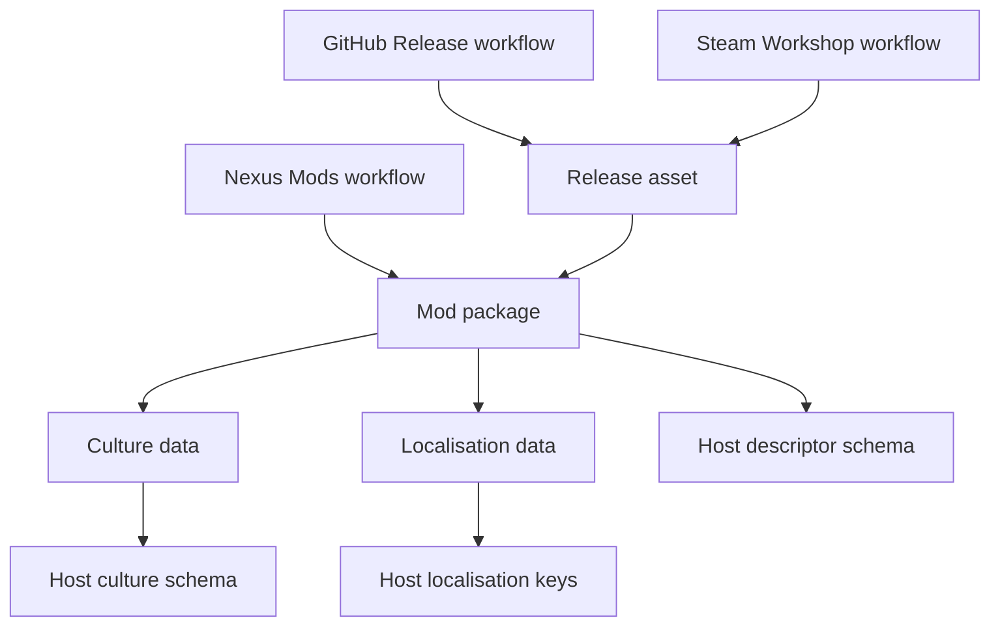

# Dependencies

## Host dependency

| Dependency | Responsibility | Boundary | Consequence of its change |
|------------|----------------|----------|---------------------------|
| Imperator: Rome 2.0.x | Supplies the culture group schema, the levy template namespace, the localisation key namespace, and the virtual filesystem override mechanism | `supported_version` gate and the data schema | A schema change invalidates the culture data or the localisation records; a version outside 2.0.x refuses to mount the mod |
| Host levy template `levy_dacians` | Defines levy composition referenced by the group and overridden for `odrysi` | `game/common/levy_templates/01_dacians.txt` | Removing or renaming the template in the host breaks the reference; the mod does not define it |
| Host localisation keys | `shamanism`, `convert_to_shamanism`, `convert_to_shamanism_desc`, `desc_shamanism`, `treasure_axe_of_zalmoxis`, `treasure_axe_of_zalmoxis_desc` | `game/localization/english/*.yml` | Renaming a key in the host orphans the mod record and restores the vanilla text |

## Platform and tooling dependencies

| Dependency | Responsibility | Integration boundary | Consequence of its change |
|------------|----------------|----------------------|---------------------------|
| GitHub Actions | Executes the release workflows | GitHub Release on release publication; Steam Workshop and Nexus Mods on `v*.*.*` tag push | A runner or syntax change in the workflow format disrupts publication |
| `hmlendea/steam-workshop-update@latest` | Uploads the package to the Workshop item | Action input interface, pinned to `@latest` | A breaking change in the action's inputs fails the upload step; because the reference is unpinned, behaviour may change without any repository change |
| `softprops/action-gh-release@v2` | Attaches the built archive to the GitHub release | Action input interface, pinned to `v2` | A breaking change in the action's inputs fails the publish step |
| Steam Workshop | Hosts and delivers the published item | Application `859580`, item `1745923673` | Item relocation or identifier change invalidates the workflow inputs |
| Nexus Mods | Secondary distribution channel | `imperatorrome/mods/24`, file `526528` | File relocation or identifier change invalidates the workflow input |
| `Nexus-Mods/upload-action@v1.0.0-beta.11` | Uploads the package to the Nexus Mods file | Action input interface, pinned to `v1.0.0-beta.11` | A breaking change in the action's inputs fails the upload step |
| GitHub Releases | Holds the versioned archive produced by the Release workflow | Asset naming contract | A renamed or absent asset is a distribution gap; the Workshop and Nexus Mods workflows build their own archives and are unaffected |
| Git | Version control and tag-based release triggers | Tag pattern `v*.*.*` | Tag naming drift breaks both the trigger and the asset resolution |

## Internal dependencies

None. The repository contains no executable content, so no internal module or package dependency exists.

## Data dependencies on other mods

None. The mod references only host-declared identifiers and does not depend on another mod. Conversely, no other mod is known to depend on this one, but that cannot be verified from the repository; it is recorded in [operations/ambiguities-and-open-questions.md](./operations/ambiguities-and-open-questions.md).

## Dependency direction

The direction is acyclic. Automation reads the package, the package references the host schema, and the host schema depends on nothing in this repository.

## Version compatibility

| Surface | Declared | Basis |
|---------|----------|-------|
| Host version | `2.0.*` | Descriptor gate |
| Release assets | `v2.0.0` current | GitHub release listing |
| Historical tags | `v1.0.1`, `v19.139` | Git tag list |

The release archive is produced by `.github/workflows/github-release.yml` rather than attached by hand; earlier releases predate that workflow.

The legacy `v19.139` tag predates the repository's semantic-versioning convention and is retained for historical releases. Future releases are expected to follow the `v*.*.*` form that the workflow trigger requires.

## Verification methods

| Dependency | Verification method |
|------------|---------------------|
| Host schema and key locations | Direct inspection of the installed game data under `game/common/cultures/` and `game/localization/english/` |
| Workflow inputs | Read of `.github/workflows/github-release.yml`, `.github/workflows/steam-workshop-release.yml`, and `.github/workflows/nexus-mods-release.yml` |
| Workshop identification | Read of the workflow inputs, together with the Workshop item identifier in the README |
| Release assets | GitHub API release listing |
| Action pinning | Read of the workflow `uses` field |

## Updating dependencies

There is no lockfile, manifest, or update command. The applicable maintenance act is the revision of a workflow input when the action's interface changes, or the revision of a descriptor when the host version moves. Both procedures are in [operations/change-guide.md](./operations/change-guide.md).

## Related documentation

- [architecture.md](./architecture.md) — why the dependency direction is one-way.
- [build-and-deployment.md](./build-and-deployment.md) — the pipeline that consumes these dependencies.
- [integrations.md](./integrations.md) — the external systems in integration terms.
- [invariants.md](./invariants.md) — the properties whose violation signals a broken dependency.
