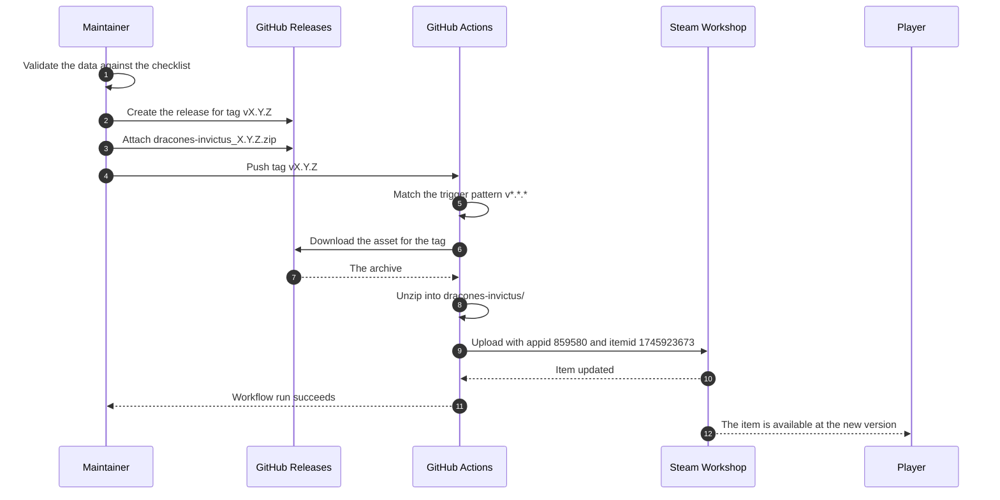
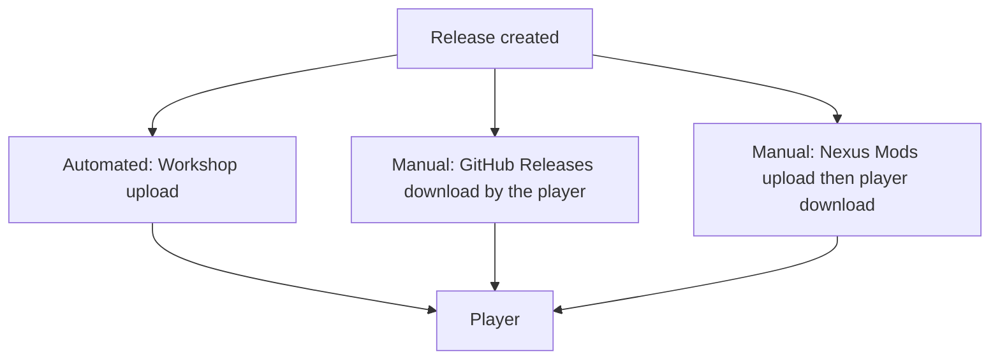

# Flow: release and publishing

This flow covers what happens from the maintainer deciding to publish to the content appearing on the Steam Workshop.

## Preconditions

- The mod data has passed the manual validation checklist in [testing.md](../testing.md).
- The intended version is decided.
- The descriptors carry the intended `supported_version`.

## Sequence

## Step detail

| Step | Actor | Input | Output | Failure behaviour |
|------|-------|-------|--------|-------------------|
| 1 | Maintainer | Changed data | Validated content | A missed check publishes an unvalidated package |
| 2 | Maintainer | Version number | A release object | A release without an asset breaks the next step |
| 3 | Maintainer | Archive | An attached asset usable by the workflow | A misnamed asset breaks the download |
| 4 | Maintainer | Tag | A workflow trigger | A tag outside the pattern does not trigger anything |
| 5 | Actions | The tag reference | A resolved asset URL | A malformed construction fails the download |
| 6 | Actions | The asset URL | The archive in the workspace | A download failure aborts the job |
| 7 | Actions | The archive | The mod directory in the workspace | An extra nesting level produces a doubly nested tree; see [build-and-deployment.md](../build-and-deployment.md) |
| 8 | Actions | The directory and the secrets | A published Workshop revision | An authentication or interface failure aborts the job |
| 9 | Player | A subscription | The updated mod | None |

## The asset name computation

The download step computes the asset name from the tag in two parts:

| Part | Source | Value for tag `v2.0.0` |
|------|--------|------------------------|
| Repository and tag | `github.ref_name` | `v2.0.0` |
| Version suffix | `GITHUB_REF:11`, stripping `refs/tags/v` | `2.0.0` |
| Full asset name | Concatenation | `dracones-invictus_2.0.0.zip` |

Any deviation in the tag prefix length, the tag scheme, or the asset naming shifts the result and breaks the download. The contract is recorded in [invariants.md](../invariants.md).

## Alternate and manual paths

The automated path publishes the Workshop item. The manual paths are independent and require no workflow.

## Non-obvious behaviours

| Behaviour | Explanation |
|-----------|-------------|
| The workflow does not build anything | The archive must already exist as a release asset |
| A tag without a release asset fails the job | The download step has no fallback |
| The change note points at another repository | The `changenote` input links to `more-cultural-names`; recorded in [operations/ambiguities-and-open-questions.md](../operations/ambiguities-and-open-questions.md) |
| A failed upload leaves the previous item content | No partial state is introduced |
| No rollback exists | Correcting a bad release means publishing another release |

## Verifying a release

1. Confirm that the workflow run completed both the `Prepare` and `Upload` steps.
2. Confirm that the Workshop item shows the new version.
3. Confirm that the change note renders as a link.
4. Optionally, load the game and run the visual checks in [testing.md](../testing.md).

## Related documentation

- [build-and-deployment.md](../build-and-deployment.md) — the pipeline reference.
- [integrations.md](../integrations.md) — the external systems involved.
- [operations/troubleshooting.md](../operations/troubleshooting.md#publishing-failures) — diagnosis.
