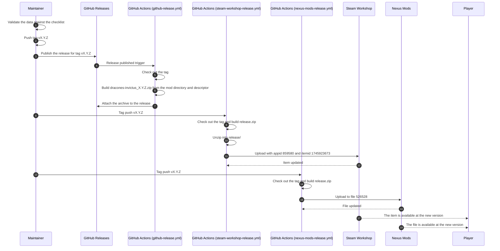
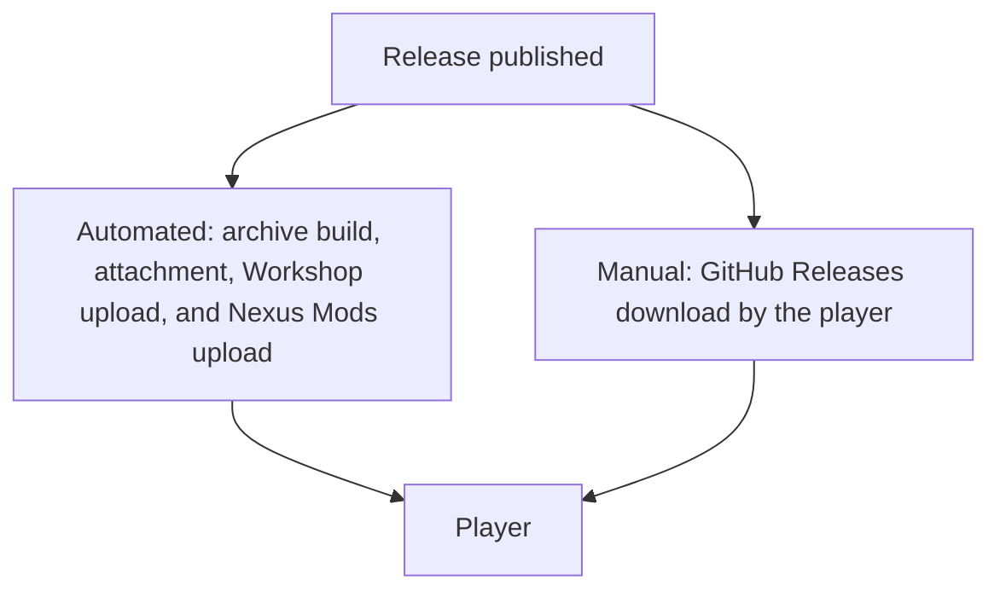

# Flow: release and publishing

This flow covers what happens from the maintainer deciding to publish to the content appearing on the Steam Workshop.

## Preconditions

- The mod data has passed the manual validation checklist in [testing.md](../testing.md).
- The intended version is decided.
- The descriptors carry the intended `supported_version`.

## Sequence

## Step detail

| Step | Actor | Input | Output | Failure behaviour |
|------|-------|-------|--------|-------------------|
| 1 | Maintainer | Changed data | Validated content | A missed check publishes an unvalidated package |
| 2 | Maintainer | Version number | A tag and a published release | A release published without the tag, or a tag without a release, breaks a later step |
| 3 | Actions (`github-release.yml`) | The released tag | A checked-out tag | A malformed tag reference fails the job |
| 4 | Actions (`github-release.yml`) | The tag name | A version with the leading `v` stripped | A tag outside the scheme produces an odd archive name |
| 5 | Actions (`github-release.yml`) | The mod directory and descriptor | An attached archive | A missing path fails the `zip` step |
| 6 | Maintainer | Tag | A Workshop and Nexus Mods workflow trigger | A tag outside the pattern does not trigger anything |
| 7 | Actions (`steam-workshop-release.yml`) | The tag | A checked-out tag and a built archive | A missing path fails the `zip` step |
| 8 | Actions (`steam-workshop-release.yml`) | The archive | The extracted tree under `release/` | An extra nesting level produces a doubly nested tree; see [build-and-deployment.md](../build-and-deployment.md) |
| 9 | Actions (`steam-workshop-release.yml`) | The directory and the secrets | A published Workshop revision | An authentication or interface failure aborts the job |
| 10 | Actions (`nexus-mods-release.yml`) | The tag and the secrets | A built archive | A missing path or an authentication failure aborts the job |
| 11 | Actions (`nexus-mods-release.yml`) | The archive | An updated Nexus Mods file | An upload or version conflict aborts the job |
| 12 | Player | A subscription or download | The updated mod | None |

## The archive name computation

The `github-release.yml` build step computes the asset name from the tag in two parts:

| Part | Source | Value for tag `v2.0.0` |
|------|--------|------------------------|
| Leading `v` | Stripped from the tag name | `2.0.0` |
| Full asset name | `dracones-invictus_<version>.zip` | `dracones-invictus_2.0.0.zip` |

The Workshop and Nexus Mods workflows build their own archives from the checked-out tag and do not depend on this name. The contract is recorded in [invariants.md](../invariants.md).

## Alternate and manual paths

The automated path attaches the archive, publishes the Workshop item, and uploads to Nexus Mods. All three channels are now workflow-driven.

## Non-obvious behaviours

| Behaviour | Explanation |
|-----------|-------------|
| The workflows do not compile anything | Each archive is built by zipping the already-authored mod directory |
| Each workflow builds its own archive | None consumes the GitHub release asset, so the release publication and the tag push are independent |
| The change note points at this repository | The `changenote` input links to `imperator-dracones-invictus`, correcting the earlier `more-cultural-names` defect; recorded in [operations/ambiguities-and-open-questions.md](../operations/ambiguities-and-open-questions.md) |
| A failed upload leaves the previous item content | No partial state is introduced |
| No rollback exists | Correcting a bad release means publishing another release |

## Verifying a release

1. Confirm that the GitHub Release workflow attached the archive.
2. Confirm that the Workshop workflow run completed the `Build the release archive`, `Extract the release archive`, and `Upload` steps, and that the item shows the new version.
3. Confirm that the Nexus Mods workflow run completed the `Build the release archive` and `Upload` steps, and that the file shows the new version.
4. Optionally, load the game and run the visual checks in [testing.md](../testing.md).

## Related documentation

- [build-and-deployment.md](../build-and-deployment.md) — the pipeline reference.
- [integrations.md](../integrations.md) — the external systems involved.
- [operations/troubleshooting.md](../operations/troubleshooting.md#publishing-failures) — diagnosis.
