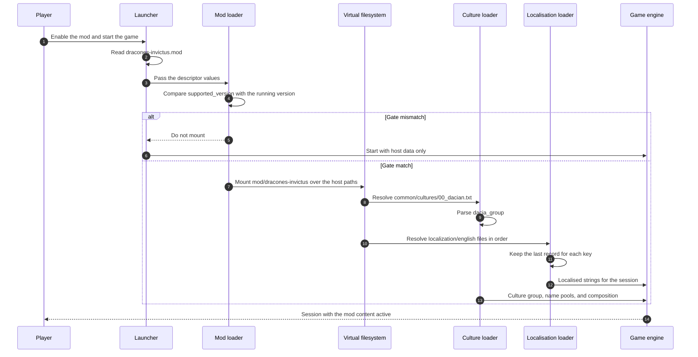
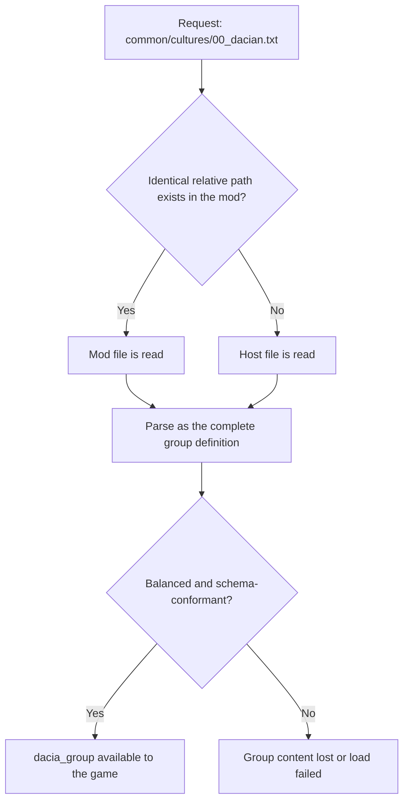
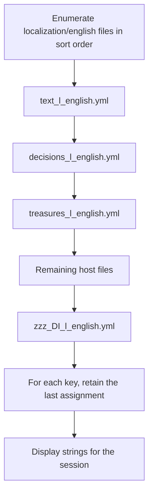

# Flow: startup and mounting

This flow covers what happens from the player starting the game to the mod's data being active. Every step belongs to the host; the mod contributes declarations.

## Sequence

## Step detail

| Step | Actor | Input | Output | Failure behaviour |
|------|-------|-------|--------|-------------------|
| 1 | Player | Enablement choice | A launcher state | None |
| 2 | Launcher | `dracones-invictus.mod` | Descriptor values including the mount path | Malformed syntax prevents mounting |
| 3 | Mod loader | `supported_version` and the host version | A mount decision | A mismatch prevents mounting, with host data retained |
| 4 | Mod loader or virtual filesystem | The mount path | The mod directory associated with the host path space | A path mismatch prevents content resolution |
| 5 | Virtual filesystem | A culture path request | The mod file, because the relative path is identical | A malformed block may cause the host to discard the group |
| 6 | Culture loader | The culture file | The `dacia_group` object with its name pools and composition | Host-owned |
| 7 | Localisation loader | All localisation files in order | One string per key, from the last file that declares it | A key mismatch leaves the host value in place |
| 8 | Game engine | Culture and string data | Session-visible content | Host-owned |

## Resolution detail for the culture surface

The culture surface resolves by path identity, so the flow has no ordering branch.

The critical property is at the `Parse` node: the mod file is treated as the whole group, not as an addition to the host file. See DD-1 in [design-decisions.md](../design-decisions.md).

## Resolution detail for the localisation surface

The localisation surface resolves by ordering, so it has an explicit ordering branch.

Because the mod file sorts last, its six records win their keys, and the rest of the keys come from the host files.

## What can go wrong, and where it surfaces

| Branch | Trigger | Where it surfaces | Documented in |
|--------|---------|-------------------|---------------|
| Gate mismatch | Host version outside 2.0.x | Launcher or absent content | [configuration.md](../configuration.md) |
| Path mismatch | Directory renamed without a descriptor revision | Absent content | [invariants.md](../invariants.md) |
| Malformed culture block | Failed structural edit | Absent or degraded group data | [error-handling.md](../error-handling.md) |
| Key mismatch | Mistyped localisation key | Vanilla text retained | [operations/troubleshooting.md](../operations/troubleshooting.md) |
| Precedence margin lost | Shortened filename prefix | Vanilla text retained | [concurrency-and-scheduling.md](../concurrency-and-scheduling.md) |

## Related documentation

- [architecture.md](../architecture.md) — the two override mechanisms explained.
- [api-reference/INDEX.md](../api-reference/INDEX.md) — the data contracts consumed here.
- [operations/troubleshooting.md](../operations/troubleshooting.md) — diagnosis of the failure branches.
