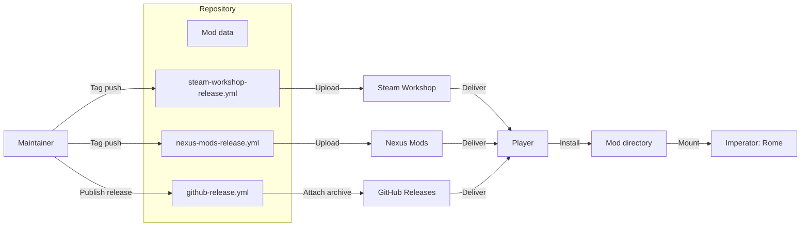

# Integrations

## Integration inventory

| System | Direction | Purpose | Owner | Interface |
|--------|-----------|---------|-------|-----------|
| Imperator: Rome mod loader | Inbound | Reads the descriptor and mounts the package | Paradox Interactive | Declarative files at host-defined paths |
| Imperator: Rome culture loader | Inbound | Reads the culture group definition | Paradox Interactive | Clausewitz-script data at `common/cultures/` |
| Imperator: Rome localisation loader | Inbound | Reads the text records | Paradox Interactive | Localisation YAML at `localization/english/` |
| Steam Workshop | Outbound | Publishes and delivers the packaged mod | Valve | Upload action with application and item identifiers |
| GitHub Releases | Outbound | Hosts the versioned archive that the Workshop workflow retrieves | GitHub | Release asset at a deterministic URL |
| GitHub Actions | Infrastructure | Executes the publication pipeline | GitHub | Release-published and tag-triggered workflows |
| Nexus Mods | Outbound | Secondary distribution | Nexus Mods | Upload action with a file identifier |

## Integration detail

### Host loader

| Aspect | Detail |
|--------|--------|
| Contract | The descriptor schema, the `supported_version` pattern, and the `path` mount point |
| Failure semantics | The host refuses to mount on a version mismatch, and cannot resolve content on a path mismatch |
| Mod-side control | None; the mod supplies the declaration only |
| Verification | In-game load, or launcher indication |

### Workshop upload action

| Aspect | Detail |
|--------|--------|
| Inputs consumed | `appid`, `itemid`, `path`, `changenote` |
| Environment consumed | `STEAM_USERNAME`, `STEAM_PASSWORD`, `STEAM_2FA_SEED` |
| Pinning | `@latest`, which is unpinned and therefore a supply-chain coupling |
| Failure semantics | The job fails and the item retains its previous content |
| Mod-side control | The workflow may be revised; the action's own behaviour may not |

### Nexus Mods upload action

| Aspect | Detail |
|--------|--------|
| Inputs consumed | `api_key`, `file_id`, `filename`, `display_name`, `version`, `description`, `category`, `archive_existing_version`, `update_mod_version` |
| Environment consumed | `NEXUSMODS_API_KEY` (repository secret) |
| Pinning | `v1.0.0-beta.11` |
| Failure semantics | The job fails and the Nexus Mods file retains its previous version |
| Mod-side control | The workflow builds its own archive and may be revised freely |

### Release archive

| Aspect | Detail |
|--------|--------|
| Contract | An asset named `dracones-invictus_<tag-without-v>.zip` attached to the published release |
| Producer | The `github-release.yml` workflow `Build the release archive` step |
| Consumer | The GitHub Releases distribution channel and manual downloaders |
| Failure semantics | A missing or misnamed asset is a distribution gap for GitHub Releases; the Workshop and Nexus Mods workflows build their own archives |
| Mod-side control | The asset is built automatically from the mod directory and the root descriptor |

## Integration topology

## Adding a distribution channel

1. Determine whether the channel requires a package layout that differs from the mod directory. If it does, the packaging step changes, not the mod data.
2. If the channel can be automated, add a separate workflow rather than extending the existing one, so a failure in one channel does not block the other.
3. If the channel requires credentials, add them as repository secrets and reference them only in the new workflow.
4. Add the channel to the README installation section, using the evidence-based badge convention already present.
5. Add a row to the channel table in [build-and-deployment.md](./build-and-deployment.md).

No channel addition requires a change to the mod data, because the package is the unit that channels deliver.

## Removing a distribution channel

1. Remove the workflow if the channel was automated.
2. Remove the installation badge and links from the README.
3. Confirm that `path` and the descriptor values remain valid for the remaining channels.
4. Record the removal in [design-decisions.md](./design-decisions.md) if the reason is consequential.

## Integration risks

| Risk | Coupling | Consequence |
|------|----------|-------------|
| Host schema change | Data files to host parser | Content may be discarded or the mod may fail to mount |
| Host version change | `supported_version` to host version | Mount refusal |
| Action interface change | Workflow inputs to action | Publication failure |
| Workshop identifier change | Workflow inputs to item | Publication to a wrong or nonexistent item |
| Archive naming drift | Release asset name to workflow download URL | Publication failure |
| Nexus file identifier change | Workflow input to file | Publication to a wrong or nonexistent file |
| Channel policy change | Publication to platform rules | Item delisting or removal |

## Related documentation

- [dependencies.md](./dependencies.md) — the same couplings in dependency terms.
- [security.md](./security.md) — the supply-chain view.
- [flows/release-and-publishing.md](./flows/release-and-publishing.md) — the publication sequence.
