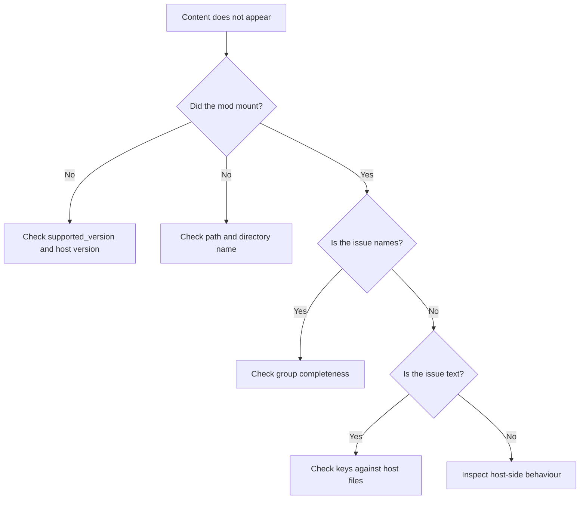

# Troubleshooting

Diagnosis for the failure modes this mod can exhibit. Every symptom here is silent by nature: the mod fails by *not* taking effect rather than by raising an error.

## Load failures

### The mod does not appear in the launcher

| Check | Expected |
|-------|----------|
| The launcher descriptor exists at the repository root | `dracones-invictus.mod` |
| `name` is a valid quoted string | `name="Dracones Invictus"` |
| `path` names a directory that exists | `mod/dracones-invictus` matching the directory `dracones-invictus/` |
| The file uses the same field syntax as the host descriptors | Quoted values, braces around `tags` |

### The launcher shows a version warning or the content is absent

| Check | Expected |
|-------|----------|
| The host version | Within 2.0.x |
| `supported_version` in both descriptors | `2.0.*` |
| The two descriptors agree | Identical values |

A host version outside the declared pattern causes the loader to refuse to mount the mod, and the game proceeds with host data only.

### The mod mounts but no names appear

| Check | Expected |
|-------|----------|
| `dacia_group` opens and closes once | Balanced braces |
| The added tokens are inside `male_names` or `female_names` | Correct block |
| The tokens are inside the mod section | After the `# Dracones Invictus - Dacian` comment |
| Host fields are all still present | No field was dropped during the edit |

Because the override is whole-file, a broken group declaration can lose the whole group rather than just the additions.

## Text problems

### The faith or conversion text does not change

| Check | Expected |
|-------|----------|
| The keys used in the mod file | `shamanism`, `desc_shamanism`, `convert_to_shamanism`, `convert_to_shamanism_desc` |
| The host declares those keys | In `text_l_english.yml` and `decisions_l_english.yml` |
| The mod file sorts after the host files | `zzz_` prefix intact |
| The file header | `l_english:` at column zero |
| Each record | One leading space, then `key:0 "value"` |
| Encoding | UTF-8 with a byte order mark |

### The treasure display name does not change

This is a known defect rather than a misconfiguration.

| Aspect | Detail |
|--------|--------|
| Symptom | The axe remains named `Zalmoxis' Axe` |
| Cause | The record key is `treasure_axe_of_zalmoxis.yml`, but the host key is `treasure_axe_of_zalmoxis` |
| Mechanism | The mismatch defines a new unused key instead of superseding the host key, and last-wins matching never pairs them |
| Correction | Use the host key verbatim, without the `.yml` fragment |
| Related | [invariants.md](../invariants.md) I-4, [operations/ambiguities-and-open-questions.md](./ambiguities-and-open-questions.md) |

Do not misdiagnose this as a precedence problem. Changing the filename or the prefix will not correct it, because the key itself is wrong.

### Some text changed and some did not

This usually indicates a partial key correction. Verify each key individually against its host file, because the records are independent.

## Publishing failures

### The workflow does not run

| Check | Expected |
|-------|----------|
| The tag pattern | `v` followed by three dot-separated numbers |
| The workflow file is on the default branch | `.github/workflows/steam-workshop-release.yml` |
| The workflow file is valid YAML | No indentation error |

### The archive build fails

| Check | Expected |
|-------|----------|
| The GitHub Release workflow ran for the published release | Yes |
| The Workshop and Nexus Mods workflows ran for the tag | Yes |
| The packaged paths exist in the tag | `dracones-invictus/` and `dracones-invictus.mod` |

### The Workshop upload step fails

| Check | Expected |
|-------|----------|
| The secrets exist | `STEAM_USERNAME`, `STEAM_PASSWORD`, `STEAM_2FA_SEED` |
| The secrets are current | Not expired or rotated out |
| The action inputs are accepted | The action's current input interface |
| The extracted directory name | `release/dracones-invictus/` matching the workflow `path` input |

An action interface change is a plausible cause, because the workflow references the action as `@latest` rather than pinning a version. See [dependencies.md](../dependencies.md).

### The Nexus Mods upload fails

| Check | Expected |
|-------|----------|
| The secret exists | `NEXUSMODS_API_KEY` |
| The file identifier matches the mod | `526528` |
| The action inputs are accepted | The action's current input interface |
| The archive contains the mod directory at its root | `dracones-invictus/` and `dracones-invictus.mod` |

### The published content is wrong

| Check | Expected |
|-------|----------|
| The validated data was tagged | Not an in-flight edit |
| The archive content matches the repository tree | No stale archive from an earlier run |
| The archive is not doubly nested | The mod directory at the archive root |

## The change note links to the wrong repository

| Aspect | Detail |
|--------|--------|
| Symptom | The Workshop change note linked to `more-cultural-names` |
| Cause | The `changenote` input in the earlier `steam-workshop.yml` referenced a different repository in its URL |
| Correction | The `steam-workshop-release.yml` workflow points the URL at `imperator-dracones-invictus` |
| Status | Corrected by the workflow replacement |
| Related | [operations/ambiguities-and-open-questions.md](./ambiguities-and-open-questions.md) |

## Diagnostic order

Work from the outside inward, because earlier layers mask later ones.

## Related documentation

- [error-handling.md](../error-handling.md) — the failure taxonomy.
- [invariants.md](../invariants.md) — the properties whose violation produces these symptoms.
- [operations/change-guide.md](./change-guide.md) — the correct procedures.
