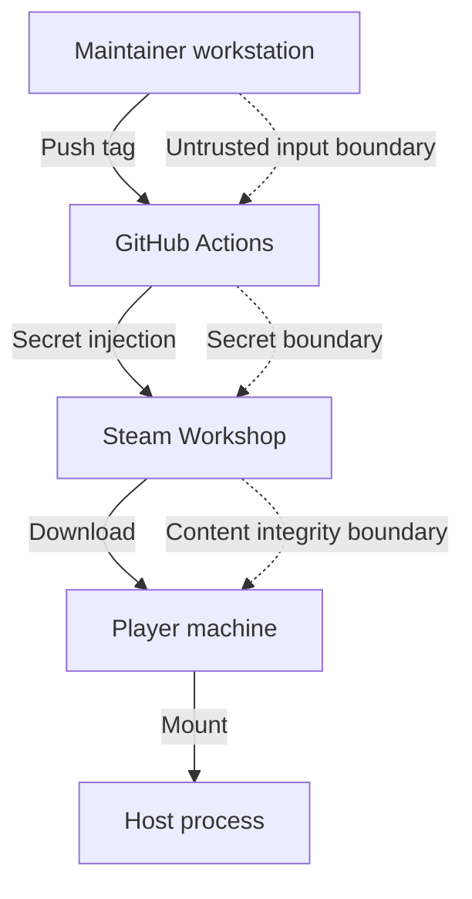

# Security

This document elaborates [../../SECURITY.md](../SECURITY.md), which defines the supported versions, the report scope, and the disclosure policy. It records the implementation-specific security posture of the mod.

## Threat surface

The mod's surface is the set of files that the host parses. There is no process, no network socket, no credential, and no input path.

| Asset | Threat | Likelihood | Impact |
|-------|--------|------------|--------|
| Culture and localisation files | Malicious substitution through a compromised distribution channel | Low | Moderate: altered game data reaches players |
| Distribution channels | Unauthorised upload or account compromise | Low | High: players subscribe to tampered content |
| Release pipeline secrets | Credential exposure through a log or a fork | Low | High: Workshop item compromise |
| Player machine | Mod directory content | Very low | The mod writes nothing |

## Trust boundaries

## Controls

| Control | Status | Evidence |
|---------|--------|----------|
| No executable content | Implemented | File inventory in [repository-structure.md](./repository-structure.md) |
| No network communication | Implemented | File inventory |
| No credential in the repository | Implemented | Workflow references secrets only |
| Secret injection at run time | Implemented | Workflow `env` block |
| Coordinated disclosure policy | Implemented | [../../SECURITY.md](../SECURITY.md) |
| Content integrity verification of the released archive | Absent | No checksum, signature, or attestation is published; recorded as a gap |
| Automated dependency review of the upload action | Absent | The action is unpinned, as recorded in [design-decisions.md](./design-decisions.md) |

## Secrets

Three secrets are consumed by the release workflow: `STEAM_USERNAME`, `STEAM_PASSWORD`, and `STEAM_2FASEED`. They are configured in the repository's settings, never in the workflow text. No other secret exists in the repository.

Handling rules:

- Never log a secret value, or a value derived from one, in a workflow step.
- Never add a `run` step that serialises the environment, because that would capture the secrets.
- Never commit a `.env`, a credential file, or an export of the workflow's environment.

## Input handling

Not applicable. The mod accepts no input at run time. All content is author-supplied data.

## Vulnerability classes

| Class | Applicable? | Reason |
|-------|-------------|--------|
| Injection | No | No code execution surface exists |
| Denial of service | No | No service, process, or resource consumption exists |
| Broken access control | No | No access control surface exists |
| Cryptographic failure | No | No cryptographic operation exists |
| Supply chain | Yes | The upload action and the distribution channels are the only external coupling |
| Tampered distribution | Yes | The absence of published checksums means a substituted archive is indistinguishable from a genuine one to a player |

## Reporting

Follow [../../SECURITY.md](../SECURITY.md). Report through GitHub Security Advisories, or contact the maintainers directly. Do not open a public issue for a suspected vulnerability.

For the distribution channels that the repository does not control, report to that channel's operator as well.

## Related documentation

- [integrations.md](./integrations.md) — the external couplings where supply-chain risk concentrates.
- [dependencies.md](./dependencies.md) — the unpinned action reference.
- [../../PRIVACY.md](../PRIVACY.md) — the data-handling position that limits the privacy surface.
