# State and persistence

## Mod-owned state

None. The mod owns no runtime state, no database, no cache, no session, and no configuration that changes after authoring. Every artefact in the repository is immutable data that the host reads.

| State kind | Owned by the mod? | Location |
|------------|-------------------|----------|
| Culture group definition | Data only, no runtime state | Static file |
| Name pools | Data only | Static file |
| Localisation records | Data only | Static file |
| Descriptor values | Data only | Static files |
| Game session state | No | Host process |
| Save game content | No | Host-managed player file |
| Launcher mod list | No | Host-managed player configuration |
| Workshop subscription | No | Steam |

## What the mod writes

Nothing. The mod contains no executable content, so it performs no write operation. Any file change observed after installation is performed by the host, the launcher, or the platform, not by the mod.

## What the mod reads

Nothing at mod level. The host reads the mod's static data. The mod has no read path of its own.

## Data lifecycle

```mermaid
stateDiagram-v2
    [*] --> Authored: Maintainer edits the data files
    Authored --> Committed: Commit to the repository
    Committed --> Tagged: Version tag pushed
    Tagged --> Released: Release published and archive attached by the GitHub Release workflow
    Tagged --> Published: Nexus Mods upload by the Nexus Mods workflow
    Released --> Published: Workshop upload by the Steam Workshop workflow or manual channel upload
    Published --> Installed: Player installs or subscribes
    Installed --> Mounted: Host loader reads the data
    Mounted --> Session: Data is active in game
    Session --> [*]: Session ends; nothing persisted by the mod
    Installed --> Uninstalled: Player deletes the mod directory
    Uninstalled --> [*]: Data gone
```

The mod takes no part in any transition after `Mounted`. Mounting, session behaviour, uninstallation, and any player-side content that persists through a session all belong to the host.

## Persistence boundaries

| Boundary | Owner | Mod's role |
|----------|-------|------------|
| Save files | Player and host | Mod data may be referenced by identifiers that saves retain; the mod does not write saves |
| Faith definitions | Host | Mod supersedes the display text only, not the identifier |
| Character name pools | Host at run time | Mod supplies pool tokens; the naming algorithm is host-owned |
| Treasure entities | Host | Mod supersedes the display text of one treasure |
| Mod enablement | Player through the launcher | Mod supplies no enablement mechanism of its own |

## Consistency and migration

No migration problem exists, because the mod has no stored state to migrate. Two consistency rules nevertheless matter.

First, save compatibility: because the mod preserves host identifiers (see DD-3 in [design-decisions.md](./design-decisions.md)), saves made without the mod remain loadable with the mod, and the reverse holds. The only observable difference is display text.

Second, release consistency: two releases must not differ in descriptor values other than where a deliberate version change is recorded, because divergence between the two descriptor files manifests as a mount inconsistency rather than as an error.

## Cache policy

There is no cache. The host reads the data at load time and holds it in memory for the session. The mod exercises no control over that behaviour.

## Retention

The mod's data persists for exactly as long as the mod directory exists and the mod is enabled. Deleting the directory removes all of the mod's effect, with no residue, because the mod writes nothing.

## Related documentation

- [repository-overview.md](./repository-overview.md) — what the mod is.
- [flows/startup-and-mounting.md](./flows/startup-and-mounting.md) — the lifecycle sequence.
- [invariants.md](./invariants.md) — the save compatibility rule.
